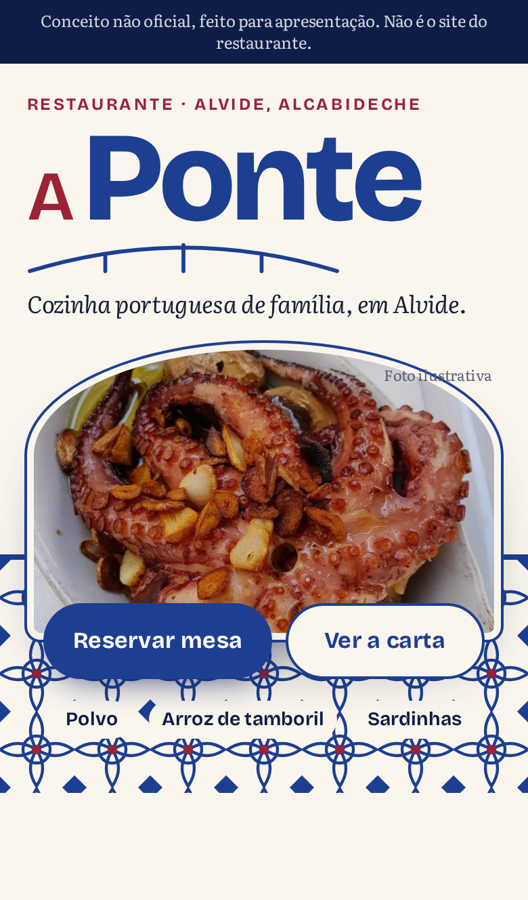

# Restaurante A Ponte · landing de demonstração

> **Conceito não oficial, feito para apresentação. Não é o site do restaurante.**

Landing page de uma página, pensada primeiro para telemóvel, para mostrar ao
Restaurante A Ponte (cozinha portuguesa tradicional em Alvide, Alcabideche)
como poderia ser o site: um só bloco de horário, carta com os pratos da casa,
reserva e morada com link de mapa. Site estático em [Astro](https://astro.build),
sem analytics, sem serviços externos e sem chaves. Página `noindex, nofollow` e
`robots.txt` a bloquear tudo. Não publicar sem o OK do David.



## Arrancar

Precisa de Node 22.18 ou mais recente.

```bash
npm ci
npm run demo
```

Abre em <http://localhost:4321>. O `--host` também o mostra na rede local, para
abrir no telemóvel ligado ao mesmo Wi-Fi (usar o endereço "Network" que aparece
no terminal). Parar com `Ctrl+C`; se o Astro o tiver posto em segundo plano
(acontece fora de um terminal interativo), parar com `npx astro preview stop`.

| Comando | O que faz |
|---|---|
| `npm run dev` | servidor de desenvolvimento |
| `npm run build` | gera o site estático em `dist/` |
| `npm test` | testes de funções, HTML gerado, créditos, prints e vídeo (precisa do build) |
| `npm run test:e2e` | testes de navegador em telemóvel e desktop (precisa do build e do Chromium do Playwright) |
| `npm run lint` | ESLint + `astro check` |
| `./verificar.sh` | instala, faz build, lint, todos os testes e confirma que o `npm run demo` serve a página |
| `npm run capturas` | regenera prints e vídeo; converte para MP4 se houver `ffmpeg` (no PATH ou em `$FFMPEG`) |

## [POR CONFIRMAR]

Tudo o que falta confirmar está em **`src/config/restaurante.ts`**, o único
ficheiro a editar. O que está a `null` aparece no site como marcador discreto
(tracejado, ex.: `—,— €`); o texto `[POR CONFIRMAR: …]` fica no `title` e para
leitores de ecrã. Nada disto foi inventado:

| Marcador | Onde aparece | Campo |
|---|---|---|
| `[POR CONFIRMAR: horário]` | bloco "Horário" (3 linhas de dias e horas + dia de descanso) | `horario`, `descanso` |
| `[POR CONFIRMAR: telefone]` | botão "Ligar" (desativado sem número) e rodapé | `telefone` |
| `[POR CONFIRMAR: WhatsApp]` | botão "WhatsApp" (desativado sem número) | `whatsapp` |
| `[POR CONFIRMAR: preço]` | os 8 pratos: polvo, arroz de tamboril, sardinhas, peixe fresco do dia, paella, costeleta de borrego, carnes grelhadas, vinho a copo | `preco` de cada prato |

Também por confirmar, sem marcador visível:

- Descrições dos pratos: são as habituais de cada prato em Portugal, não as do
  restaurante. Se a carta tem outros pratos (só estão os referidos em avaliações).
- Morada, estacionamento e serviços (ar condicionado, wi-fi, acessibilidade,
  MB Way e cartões): vêm de dados públicos que podem estar desatualizados.

## Imagens

Fotos ilustrativas do Wikimedia Commons (CC0, CC BY 4.0 e CC BY-SA 4.0), não
são do restaurante. Créditos em [`docs/CREDITOS-IMAGENS.md`](docs/CREDITOS-IMAGENS.md)
e no rodapé do site. O padrão de azulejo é um SVG desenhado para o projeto.

## Prints e vídeo

- `docs/prints/`: telemóvel (hero, carta, galeria, reserva e página inteira) e
  desktop (hero, carta e página inteira).
- `docs/video/percurso-mobile.mp4`: percurso de cerca de 54 s em telemóvel,
  incluindo o formulário de demonstração.

## Limites desta demo

- O formulário de reserva é uma simulação: mostra uma confirmação mas não envia
  nem guarda nada (está assinalado no próprio formulário).
- Mapa só por link (pesquisa no Google Maps), sem embed nem chave.

Projeto aperfeiçoado com a ajuda de IA.
